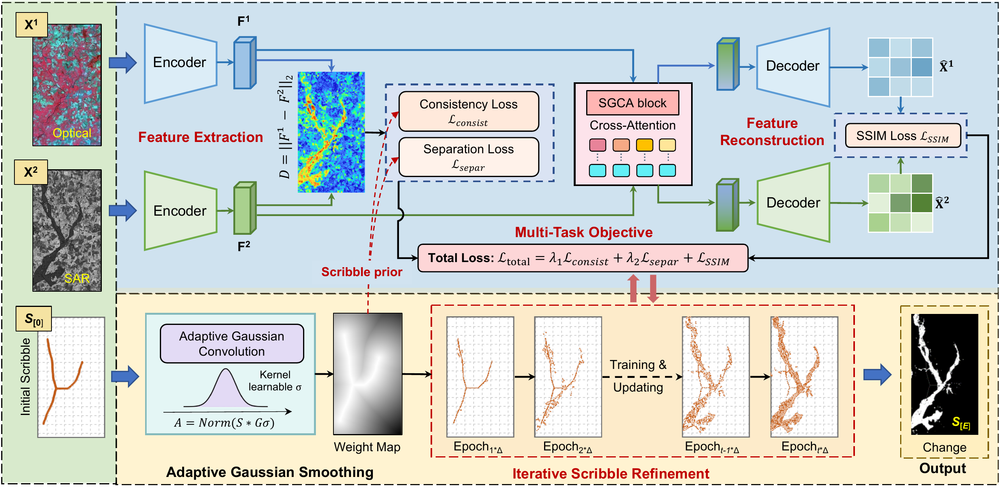
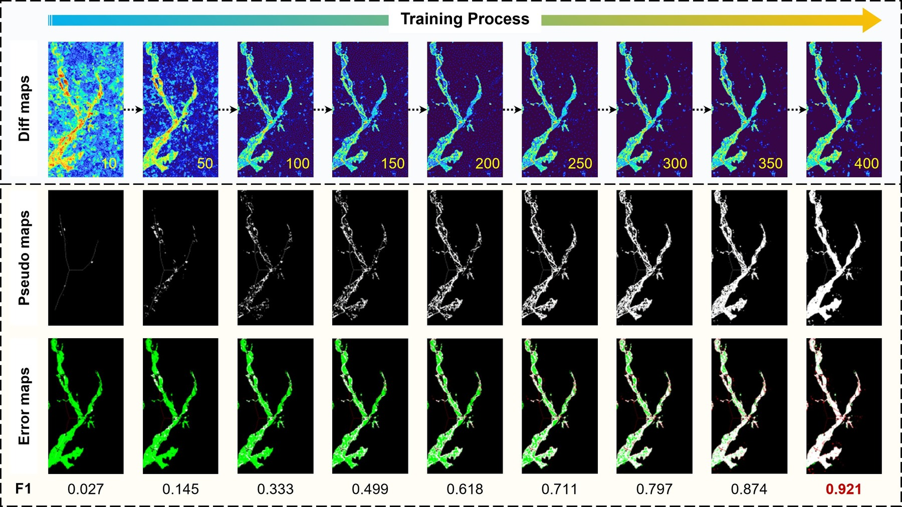
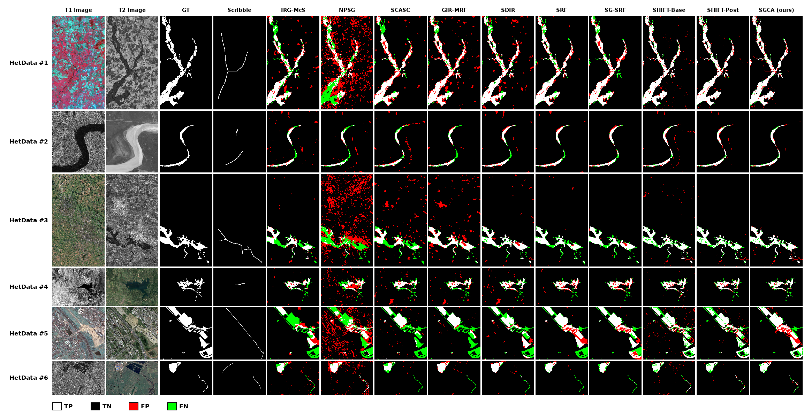

<h1 align="center">SGCA: A Scribble-Guided Cross-Attention Framework<br>for Multimodal Remote Sensing Change Detection</h1>

<p align="center">
Yongjie Zheng, Hao Liu, Houcai Guo, Sicong Liu<sup>*</sup>, Lorenzo Bruzzone<sup>*</sup>
<br>
University of Trento &nbsp;·&nbsp; Tongji University
</p>

<p align="center">
<em>ISPRS Journal of Photogrammetry and Remote Sensing</em>, vol. 235, pp. 416–427, 2026
<br>
<a href="https://doi.org/10.1016/j.isprsjprs.2026.03.015"></a>
<a href="https://www.sciencedirect.com/science/article/pii/S0924271626001292"></a>
<a href="LICENSE"></a>
</p>

This is the official PyTorch implementation of **SGCA**, a weakly supervised framework for multimodal
(heterogeneous) remote sensing change detection that only requires a few sparse **scribbles** on changed
objects.

## Framework

<p align="center"></p>

Given a bi-temporal multimodal image pair and sparse scribbles, SGCA integrates (1) adaptive Gaussian
smoothing of the scribbles into a soft spatial prior, (2) a scribble-guided cross-attention block for
cross-modal alignment and structure-aware feature fusion, (3) a composite loss with consistency,
separation and SSIM-based reconstruction terms, and (4) dynamic scribble learning that progressively
expands the supervision. The evolved pseudo change map is the final change mask.

<p align="center"></p>
<p align="center"><em>Training process on HetData #1: difference maps (top), evolving pseudo maps (middle) and their error maps (bottom).</em></p>

## Main results

Quantitative comparison on six heterogeneous datasets (OA / Kappa / F1, Table 3 of the paper):

| Method | HetData #1 | HetData #2 | HetData #3 | HetData #4 | HetData #5 | HetData #6 |
|---|---|---|---|---|---|---|
| IRG-McS | 0.938 / 0.715 / 0.750 | 0.976 / 0.676 / 0.688 | 0.970 / 0.718 / 0.733 | 0.971 / 0.739 / 0.754 | 0.864 / 0.357 / 0.427 | 0.969 / 0.654 / 0.671 |
| NPSG | 0.753 / 0.194 / 0.323 | 0.976 / 0.638 / 0.650 | 0.775 / -0.002 / 0.093 | 0.910 / 0.415 / 0.460 | 0.737 / 0.135 / 0.290 | 0.939 / 0.563 / 0.591 |
| SCASC | 0.947 / 0.762 / 0.793 | 0.972 / 0.632 / 0.646 | 0.936 / 0.485 / 0.519 | 0.953 / 0.607 / 0.632 | 0.896 / 0.487 / 0.538 | 0.973 / 0.645 / 0.659 |
| GIR-MRF | 0.932 / 0.720 / 0.759 | 0.984 / 0.750 / 0.758 | 0.950 / 0.667 / 0.693 | 0.960 / 0.674 / 0.695 | 0.903 / 0.515 / 0.562 | 0.982 / 0.810 / 0.819 |
| SDIR | 0.938 / 0.738 / 0.773 | 0.978 / 0.715 / 0.726 | 0.980 / 0.831 / 0.842 | 0.955 / 0.652 / 0.676 | 0.912 / 0.600 / 0.649 | 0.986 / 0.843 / 0.850 |
| SRF | 0.968 / 0.851 / 0.869 | 0.982 / 0.752 / 0.761 | 0.978 / 0.788 / 0.800 | 0.971 / 0.755 / 0.771 | 0.914 / 0.652 / 0.703 | 0.987 / 0.838 / 0.845 |
| SG-SRF | 0.962 / 0.823 / 0.845 | 0.988 / 0.817 / 0.823 | 0.980 / 0.814 / 0.825 | 0.972 / 0.767 / 0.782 | 0.922 / 0.690 / 0.736 | 0.987 / 0.838 / 0.845 |
| SHIFT-Base | 0.977 / 0.895 / 0.908 | 0.983 / 0.767 / 0.776 | 0.980 / 0.824 / 0.834 | 0.975 / 0.783 / 0.797 | 0.926 / 0.701 / 0.745 | 0.975 / 0.729 / 0.742 |
| SHIFT-Post | 0.981 / 0.911 / 0.922 | 0.988 / 0.827 / 0.833 | 0.983 / 0.850 / 0.859 | 0.977 / 0.796 / 0.808 | 0.938 / 0.742 / 0.777 | 0.984 / 0.799 / 0.807 |
| **SGCA (ours)** | **0.980 / 0.910 / 0.921** | **0.989 / 0.840 / 0.845** | **0.985 / 0.878 / 0.885** | **0.979 / 0.807 / 0.818** | **0.931 / 0.737 / 0.778** | **0.987 / 0.843 / 0.850** |

Qualitative comparison (Fig. 4 of the paper). Columns: (a) T1 image, (b) T2 image, (c) ground truth,
(d) scribbles, change maps of (e) IRG-McS, (f) NPSG, (g) SCASC, (h) GIR-MRF, (i) SDIR, (j) SRF,
(k) SG-SRF, (l) SHIFT-Base, (m) SHIFT-Post and (n) SGCA. TP white, TN black, FP red, FN green.

<p align="center"></p>

The change maps of SGCA on every dataset are provided in [`results/`](results/):

```
results/hetdataX/
├── gray_map.png     # change intensity (feature-difference) map
├── binary_map.png   # binary change map (white = changed)
└── error_map.png    # binary error map: TP white, TN black, FP red, FN green
```

The change maps of all compared methods are in [`assets/comparison/`](assets/comparison/).

## Installation

Core dependencies:

| Package | Version used |
|---|---|
| Python | 3.10 |
| PyTorch | 2.2 (CUDA 12.1) |
| pytorch-msssim | 1.0 |
| opencv-python | 4.x |
| scikit-image | 0.24 |
| scipy, numpy, imageio, pyyaml, matplotlib, pillow | – |

```bash
git clone https://github.com/MissYongjie/SGCA.git
cd SGCA
conda create -n sgca python=3.10 -y
conda activate sgca
pip install torch torchvision --index-url https://download.pytorch.org/whl/cu121   # choose the build matching your CUDA
pip install -r requirements.txt
```

## Data

The six heterogeneous datasets used in the paper are included in [`data/`](data/), each with the
scribbles used in our experiments:

| Folder | Dataset | Sensors | Size (pixels) | Location | Event |
|---|---|---|---|---|---|
| `hetdata1` | HetData #1 | Spot / NDVI | 990 × 554 | Gloucester, England | Flooding |
| `hetdata2` | HetData #2 | Radarsat-2 / Google Earth | 343 × 291 | Yellow River, China | Embankment change |
| `hetdata3` | HetData #3 | QuickBird 2 / TerraSAR-X | 1034 × 582 | Gloucester, England | Flooding |
| `hetdata4` | HetData #4 | Landsat-5 / Google Earth | 300 × 412 | Sardinia, Italy | Lake expansion |
| `hetdata5` | HetData #5 | Pleiades / WorldView-2 | 500 × 500 | Toulouse, France | Construction |
| `hetdata6` | HetData #6 | Radarsat-2 / Google Earth | 593 × 921 | Shuguang Village, China | Building construction |

Each folder contains `t1.png`, `t2.png`, `gt.png` and `scribble.png`. See [`data/README.md`](data/README.md)
for how to add your own image pairs.

## Usage

Run SGCA on one dataset:

```bash
python tools/train.py --config configs/hetdata1.yaml
```

Run all six datasets and print the accuracy table:

```bash
bash scripts/run_all.sh
```

Outputs are written to `work_dirs/<dataset>/`: `change_map.png` (binary change map), `distance_map.png`
(change intensity map), `error_map.png` and `metrics.json` (OA, Kappa, F1, run time).

Common options:

```bash
python tools/train.py --config configs/hetdata1.yaml --device cpu             # run on CPU
python tools/train.py --config configs/hetdata1.yaml --save-intermediate      # save maps at every scribble update
python tools/train.py --config configs/hetdata1.yaml --opts optim.epochs=200  # override any config entry
```

## Citation

If you find this work useful in your research, please cite:

```bibtex
@article{zheng2026sgca,
  title   = {{SGCA}: A Scribble-Guided Cross-Attention Framework for Multimodal Remote Sensing Change Detection},
  author  = {Zheng, Yongjie and Liu, Hao and Guo, Houcai and Liu, Sicong and Bruzzone, Lorenzo},
  journal = {ISPRS Journal of Photogrammetry and Remote Sensing},
  volume  = {235},
  pages   = {416--427},
  year    = {2026},
  doi     = {10.1016/j.isprsjprs.2026.03.015}
}
```

## Acknowledgements

This work was supported by the National Natural Science Foundation of China (Grant 42071324), the
Research Project of Tongji Architectural Design (Group) Co., Ltd (2023J-JB11), and the China Scholarship
Council. We thank the providers of the public heterogeneous change detection datasets and the authors of
the compared methods for releasing their code.

## License

This project is released under the [MIT License](LICENSE).
